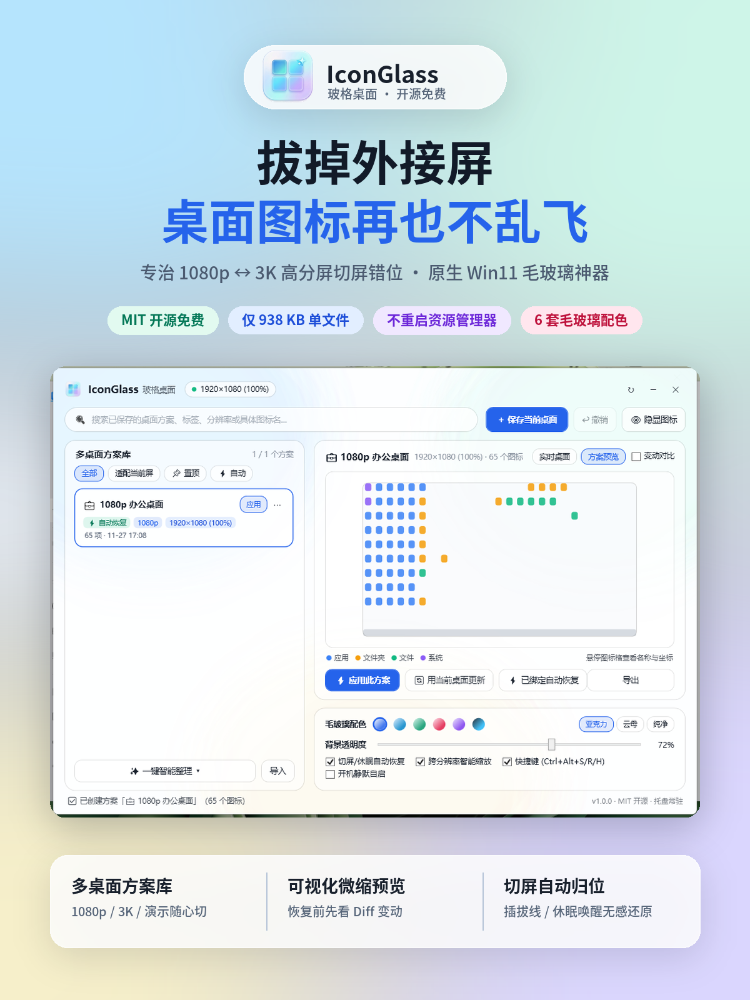
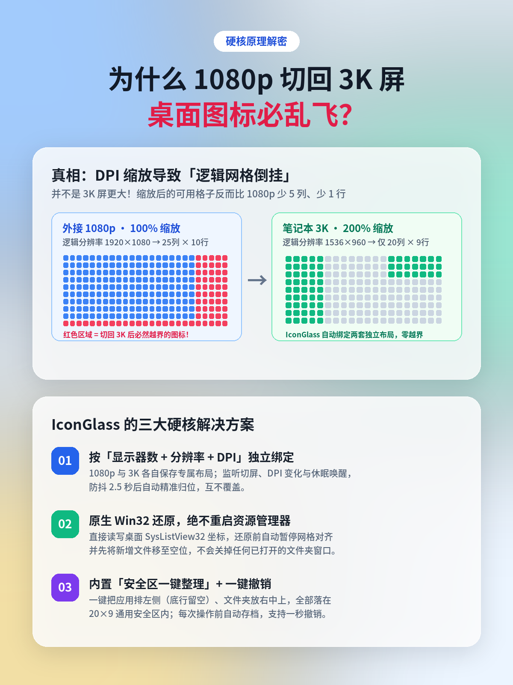
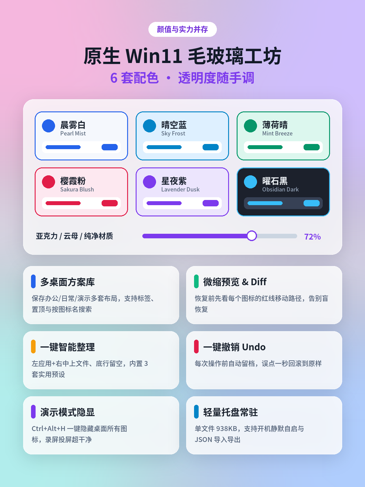
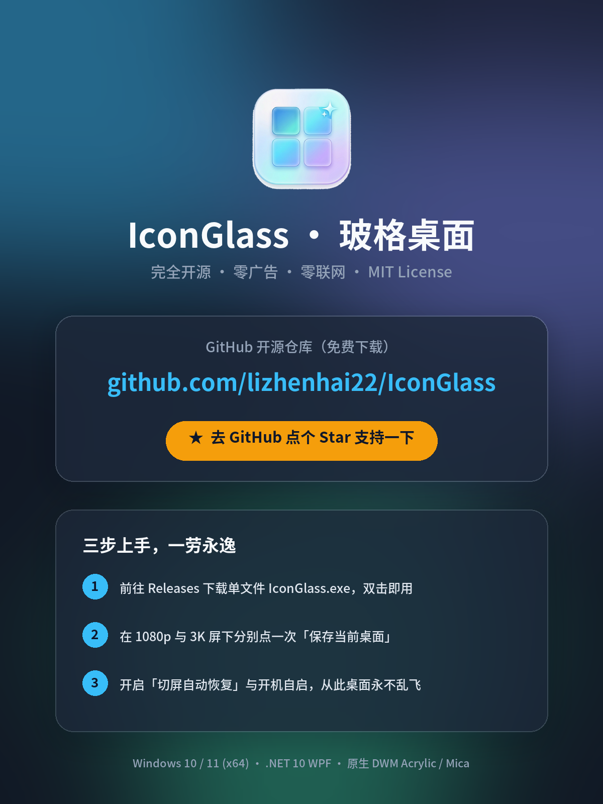

## 为什么做这个项目？

用 **3K 高分屏笔记本（200% 缩放）** 外接 **1080p 显示器（100% 缩放）** 办公，几乎每天都会被一个离谱的问题折磨：每次拔掉外接屏回到笔记本，辛辛苦苦摆好的桌面图标瞬间全乱飞。

排查 Windows 11 注册表里的 `IconLayouts` 后我才发现真相——**并不是 3K 屏更大，而是 DPI 缩放导致了「逻辑网格倒挂」**：

- 外接 **1080p（100% 缩放）**：逻辑分辨率 `1920×1080`，桌面图标网格是 **`25列 × 10行`**；
- 笔记本 **3K 屏（200% 缩放）**：逻辑分辨率 `1536×960`，桌面图标网格反而只有 **`20列 × 9行`**。

只要外接屏下有图标落在了第 10 行或第 21–25 列，一拔线切回 3K 就会触发系统越界重排，整屏图标跟着遭殃。

市面上的老牌工具要么界面停留在 XP 时代且闭源，要么收费且偏重。于是我用 **.NET 10 WPF + 原生 Win32 API（零第三方 NuGet 依赖）**，自己写了一款高颜值、轻量化、完全开源免费的替代品：**IconGlass（玻格桌面）**。

> **开源仓库**：[github.com/lizhenhai22/IconGlass](https://github.com/lizhenhai22/IconGlass)  
> **直接下载（Releases）**：[前往下载便携版 / 独立单文件版 `.exe`](https://github.com/lizhenhai22/IconGlass/releases/tag/v1.0.0)（MIT 开源，零广告、零联网）

---

## 宣传视频演示（18 秒速览）

  <video
    controls
    playsinline
    preload="metadata"
    poster="/assets/images/iconglass-poster.png"
    style="width: 100%; display: block; background: #0f172a;"
  >
    <source src="/assets/videos/iconglass-promo.webm" type="video/webm" />
    你的浏览器暂不支持 HTML5 视频播放，可查看下方的动态演示图。
  </video>

如果当前网络环境下视频加载较慢，也可以直接看动态演示图：

---

## 宣传图文一览

### 1. 痛点直击与真机界面

### 2. 1080p 与 3K 逻辑网格倒挂原理解密

### 3. Win11 原生毛玻璃工坊 & 人性化功能

### 4. 三步上手与开源获取

---

## 核心特性速览

- **原生 Win11 毛玻璃工坊**：调用 DWM 原生 `Acrylic`（亚克力）与 `Mica`（云母）实时背景模糊，支持 **亚克力 / 云母 / 纯净半透明** 一键切换、**25%–96% 实时透明度滑块**，以及 **6 套配色主题**（晨雾白 / 晴空蓝 / 薄荷晴 / 樱霞粉 / 星夜紫 / 曜石黑）。
- **多桌面方案库**：支持保存无限个自定义桌面快照（自定义 Emoji 徽章、场景标签、备注与置顶），顶部胶囊搜索栏支持按方案名、分辨率甚至**按桌面具体图标文件名**反查，支持 JSON 导入导出。
- **实时桌面微缩预览 & Diff 对比**：按真实显示器与任务栏比例着色渲染应用、文件夹、文件、系统图标；勾选「变动对比」即可用红线预览每个图标的移动路径再决定是否恢复。
- **切屏 / DPI / 休眠自动守护**：按「显示器数量 + 物理分辨率 + DPI 缩放」精准绑定自动恢复方案，监听 `WM_DISPLAYCHANGE`、`WM_DPICHANGED`、工作区变化与休眠唤醒，防抖 2.5 秒自动归位。
- **不重启资源管理器 + 防碰撞还原**：通过 Win32 `SysListView32` 跨进程 API 直接读写图标坐标，绝不关闭已打开的文件夹窗口；还原前自动暂停网格对齐并先将新增文件移至空位，彻底避免图标互相顶飞。
- **更多效率细节**：内置 **3 套一键智能整理预设**（含「左应用 · 右中上文件夹 · 底行留空」1080p/3K 通用安全区排布）、**一键撤销（Undo）**、**演示模式一键隐显桌面图标**（`Ctrl+Alt+H`）、全局快捷键与开机静默自启。

---

## 快速下载与支持

前往 [IconGlass GitHub Releases](https://github.com/lizhenhai22/IconGlass/releases) 即可免费下载：

- `IconGlass-win-x64-standalone.exe`：内置运行时的独立单文件版，双击即用（推荐）；
- `IconGlass-win-x64-net10.exe`：超轻量单文件版（仅 938 KB，需本机已安装 .NET 10 Desktop Runtime）。

如果这个小工具也帮你解决了切屏图标乱飞的烦恼，欢迎去 [GitHub 仓库](https://github.com/lizhenhai22/IconGlass) 顺手点一颗 **Star ⭐**，有任何建议或想加的新功能也欢迎在评论区或 GitHub Issue 里留言！
